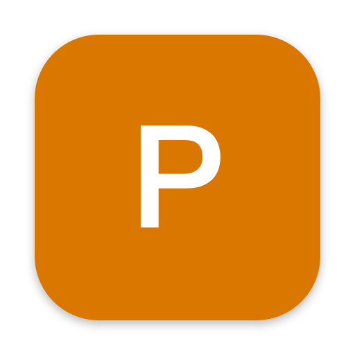

<div align="center">



# Parappa

### Live captions for everything your Mac plays, right on your Mac

[한국어](README.md) | **English** | [日本語](README.ja.md)

</div>

Parappa is a menu bar app forked from [Parakeet](https://github.com/LPFchan/parakeet) by LPFchan. It listens to whatever your Mac plays (videos, calls, podcasts) and shows captions on screen. Speech recognition and translation run entirely on your Mac; no audio or text leaves it.

What's different from Parakeet:

- Captions can sit at the bottom of the screen, the top, or wherever you dragged them. You can also pick the display and lock the position.
- Font, weight, caption size and the size of the original under its translation can all be changed.
- With Korean as the translation language, English is translated into Korean and Korean is shown as heard. Parakeet hides the captions while it hears Korean.
- Speech recognition has an **Accurate** mode: Nemotron 3.5 shows words dimmed as they're spoken, and when a sentence ends, Cohere Transcribe transcribes that stretch again and corrects it.

## Features

- Live captions for system audio: Nemotron 3.5 ASR, about 40 languages detected automatically
- Accurate mode: each sentence corrected by Cohere Transcribe 03-2026. It corrects 14 languages, including Korean, English, Japanese and Chinese; for any other language Nemotron's text is kept.
- Translation with Apple's Translation framework, into about 20 languages. macOS asks once to download each language.
- Caption position, display, and position lock (clicks pass through the captions)
- Font, weight, caption size (14–56 pt), original size (10–40 pt)
- ⇧⌘1 Translate Screen: translates the text on screen right where it is. Unchanged from Parakeet.
- Copy transcript, open at login, automatic updates

## Requirements

- Apple silicon Mac
- macOS 15 or later
- Disk: about 640 MB for the speech model, plus about 2.2 GB for Accurate mode

## Installing

1. Download `Parappa.dmg` from [Releases](https://github.com/devuterian/parappa/releases/latest).
2. Open the dmg and drag **Parappa** into **Applications**.
3. The app isn't notarized by Apple, so macOS blocks the first launch. Go to **System Settings → Privacy & Security**, click **Open Anyway**, then open it again.
4. On first launch it asks for audio access and downloads the speech model (about 640 MB) from Hugging Face.

Accurate mode (the default) downloads Cohere Transcribe (about 2.2 GB) in the background once Nemotron is ready. Captions keep working meanwhile; the first load takes a few minutes while it's prepared for the Neural Engine.

## Usage

- The menu bar icon has Captions on/off (⌘L), Copy Transcript, Translate To, Translate Screen (⇧⌘1) and **Settings…** (⌘,).
- While Settings is open, the caption box shows sample captions. Size and font changes show up right away, and you can drag the box to where you want it.
- Hovering over the caption box shows buttons to turn captions off, copy the transcript and pick a translation language. They don't show while the position is locked.
- The same switch works from a terminal:

  ```sh
  alias parappa=/Applications/Parappa.app/Contents/MacOS/Parappa
  parappa status
  parappa captions on|off
  ```

## Settings

| Setting | What it does |
| --- | --- |
| Position | Bottom of Screen, Top of Screen, Where Dragged |
| Display | Only shown with more than one display |
| Lock Position | The captions can't be dragged and their buttons don't show; clicks pass through them |
| Font, Weight | Any installed font. Fonts without Korean show Korean in a fallback font |
| Caption Size | Captions on their own, or the translation line |
| Original Size | The original shown small under its translation |
| Translate To | Off, or a language to translate into |
| Show (language) Speech Too | When off, captions hide while the speech is in the translation language (Parakeet's behavior) |
| Model | Fast (Nemotron alone), Accurate (Nemotron + Cohere Transcribe) |

## Building

Needs Xcode 26 or later.

```sh
scripts/build-app.sh          # → build/Parappa.app
open build/Parappa.app
```

It signs with the `marierie Local Code Signing` certificate if it's in the keychain, otherwise ad-hoc. With ad-hoc signing, macOS asks for audio access again after every build.

To try an engine on a 16 kHz float32 WAV (`--engine` is `nemotron`, `hybrid` for Accurate mode, or `ultra`):

```sh
build/Parappa.app/Contents/MacOS/Parappa --engine hybrid --bench clip.wav
```

Releases are published from this Mac. The signing certificate and the Sparkle private key (`~/.config/parappa/sparkle-ed25519.key`) live only on this Mac, so there's no CI release.

```sh
scripts/release.sh 3.0.0
```

## How it works

- `SystemAudioTap.swift`: captures system audio with a Core Audio process tap, as 16 kHz mono.
- `NemotronEngine.swift`: Nemotron 3.5 ASR streaming. Each 0.56 s is processed once, and words already written are never changed.
- `HybridEngine.swift`: Accurate mode. When Silero VAD hears speech stop (or, past 12 s, at the quietest moment), that stretch goes to Cohere Transcribe, and Nemotron's draft words for it are replaced with Cohere's text. Until Cohere is ready, or for a language it doesn't know, Nemotron's words are locked in as they are.
- `CaptionPanel.swift`: the caption box and translation. Position and size follow the settings in `Prefs.swift`.
- `SettingsWindow.swift`: the settings window

## License

MIT. Based on [Parakeet](https://github.com/LPFchan/parakeet) © 2026 LPFchan. Licenses of the libraries built in are in the app's `Contents/Resources/Licenses`.
