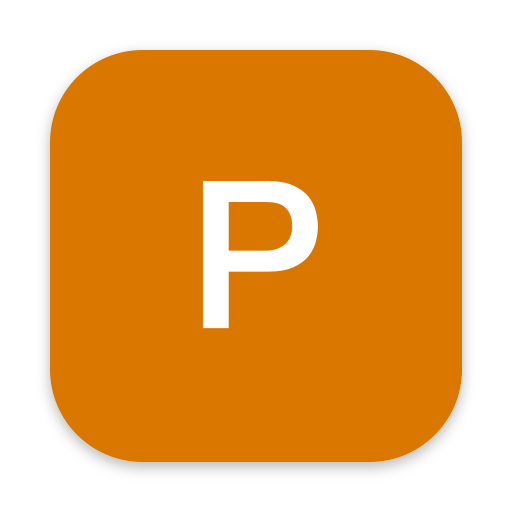

<div align="center">



# Parappa

### Mac で流れるすべての音にリアルタイム字幕を、Mac の中だけで

[한국어](README.md) | [English](README.en.md) | **日本語**

</div>

Parappa は LPFchan さんの [Parakeet](https://github.com/LPFchan/parakeet) をフォークしたメニューバーアプリです。動画、通話、ポッドキャストなど Mac で再生される音を聞き取り、画面に字幕を表示します。音声認識と翻訳はすべて Mac の中で処理され、音声やテキストが外に出ることはありません。

Parakeet との違いは次のとおりです。

- 字幕の位置を、画面下、画面上、ドラッグした場所から選べます。ディスプレイの選択や位置の固定もできます。
- フォント、太さ、字幕のサイズ、翻訳の下に出る原文のサイズを変えられます。
- 翻訳先を韓国語にしておくと、英語は韓国語に翻訳し、韓国語は聞こえたまま表示します。元の Parakeet は韓国語が聞こえると字幕を隠します。
- 音声認識に **正確** モードを追加しました。Nemotron 3.5 が話したそばから薄く表示し、文が終わると Cohere Transcribe がその区間を書き起こし直して修正します。

## 機能

- システム音声のリアルタイム字幕：Nemotron 3.5 ASR、約 40 言語を自動判別
- 正確モード：Cohere Transcribe 03-2026 で文ごとに補正。韓国語、英語、日本語、中国語など 14 言語を補正し、それ以外の言語は Nemotron の結果をそのまま使います。
- 翻訳：Apple の Translation フレームワークで約 20 言語に対応。言語ごとに初回だけ macOS がダウンロードを確認します。
- 字幕の位置、ディスプレイ、位置の固定（クリックが字幕を通り抜けます）
- フォント、太さ、字幕サイズ（14–56pt）、原文サイズ（10–40pt）
- ⇧⌘1 画面翻訳：画面上の文字をその場で翻訳します。Parakeet の機能そのままです。
- 書き起こしのコピー、ログイン時に開く、自動アップデート

## 動作環境

- Apple シリコン搭載の Mac
- macOS 15 以降
- ディスク：音声モデルに約 640MB、正確モードを使う場合はさらに約 2.2GB

## インストール

1. [Releases](https://github.com/devuterian/parappa/releases/latest) から `Parappa.dmg` をダウンロードします。
2. dmg を開き、**Parappa** を **アプリケーション** フォルダにドラッグします。
3. Apple の公証を受けていないため、初回は macOS に起動を止められます。**システム設定 → プライバシーとセキュリティ** で **このまま開く** をクリックしてから、もう一度開いてください。
4. 初回起動時にオーディオへのアクセスを求められ、音声モデル（約 640MB）を Hugging Face からダウンロードします。

正確モード（デフォルト）では、Nemotron の準備ができたあとに Cohere Transcribe（約 2.2GB）をバックグラウンドでダウンロードします。その間も字幕は表示されます。初回の読み込みは Neural Engine 向けの準備で数分かかります。

## 使い方

- メニューバーのアイコンから、字幕のオン・オフ（⌘L）、書き起こしのコピー、翻訳先、画面翻訳（⇧⌘1）、**設定…**（⌘,）を使えます。
- 設定ウインドウを開いている間は、字幕ボックスにサンプルの字幕が表示されます。サイズやフォントの変更がすぐに反映され、ボックスをドラッグして好きな場所に置けます。
- 字幕ボックスにポインタを乗せると、字幕オフ、書き起こしのコピー、翻訳先のボタンが出ます。位置を固定している間は出ません。
- ターミナルからもオン・オフできます。

  ```sh
  alias parappa=/Applications/Parappa.app/Contents/MacOS/Parappa
  parappa status
  parappa captions on|off
  ```

## 設定

| 項目 | 内容 |
| --- | --- |
| 位置 | 画面下、画面上、ドラッグした場所 |
| ディスプレイ | ディスプレイが 2 台以上あるときだけ表示されます |
| 位置を固定 | 字幕のドラッグやボタン操作ができなくなり、クリックが字幕を通り抜けます |
| フォント、太さ | インストール済みのフォントから選べます。韓国語を含まないフォントでは、韓国語だけ別のフォントで表示されます |
| 字幕サイズ | 字幕単体、または翻訳の行のサイズ |
| 原文サイズ | 翻訳の下に小さく出る原文のサイズ |
| 翻訳先 | オフ、または翻訳先の言語 |
| （言語）の音声も表示 | オフにすると、翻訳先の言語で話している間は字幕を隠します（Parakeet と同じ動作） |
| モデル | 高速（Nemotron のみ）、正確（Nemotron + Cohere Transcribe） |

## ビルド

Xcode 26 以降が必要です。

```sh
scripts/build-app.sh          # → build/Parappa.app
open build/Parappa.app
```

キーチェーンに `marierie Local Code Signing` 証明書があればそれで署名し、なければ ad-hoc で署名します。ad-hoc の場合、ビルドするたびに macOS がオーディオへのアクセスを確認し直します。

16kHz float32 の WAV でエンジンを試せます。`--engine` は `nemotron`、`hybrid`（正確モード）、`ultra` のいずれかです。

```sh
build/Parappa.app/Contents/MacOS/Parappa --engine hybrid --bench clip.wav
```

リリースはこの Mac から直接公開します。署名証明書と Sparkle の秘密鍵（`~/.config/parappa/sparkle-ed25519.key`）はこの Mac にしかないため、CI では実行しません。

```sh
scripts/release.sh 3.0.0
```

## 仕組み

- `SystemAudioTap.swift`：Core Audio のプロセスタップでシステム音声を 16kHz モノラルで受け取ります。
- `NemotronEngine.swift`：Nemotron 3.5 ASR のストリーミング。0.56 秒ごとに一度だけ処理し、書いた文字は書き換えません。
- `HybridEngine.swift`：正確モード。Silero VAD が話の切れ目を見つけると（12 秒を超えたら一番静かなところで区切ります）、その区間を Cohere Transcribe に渡し、該当する Nemotron の下書きを Cohere の結果に置き換えます。Cohere の準備ができていない間や、Cohere が対応していない言語では、Nemotron の結果をそのまま確定します。
- `CaptionPanel.swift`：字幕ボックスと翻訳。位置とサイズは `Prefs.swift` の設定に従います。
- `SettingsWindow.swift`：設定ウインドウ

## ライセンス

MIT。LPFchan さんの [Parakeet](https://github.com/LPFchan/parakeet) © 2026 をもとにしています。同梱ライブラリのライセンスはアプリ内の `Contents/Resources/Licenses` にあります。
