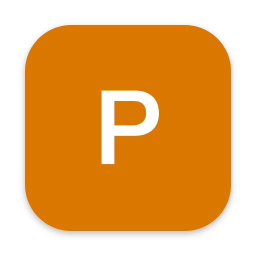

<div align="center">



# Parappa

### Mac에서 나오는 모든 소리에 실시간 자막을, Mac 안에서

**한국어** | [English](README.en.md) | [日本語](README.ja.md)

</div>

Parappa는 [Parakeet](https://github.com/LPFchan/parakeet)(LPFchan)을 포크한 메뉴 막대 앱이에요. 영상, 통화, 팟캐스트처럼 Mac에서 재생되는 소리를 듣고 화면 위에 자막을 띄워 줍니다. 음성 인식과 번역은 전부 Mac 안에서 처리되고, 오디오나 텍스트는 밖으로 나가지 않아요.

Parakeet에서 달라진 점은 아래와 같아요.

- 자막 위치를 화면 아래, 화면 위, 끌어다 놓은 자리 중에서 고를 수 있어요. 디스플레이를 고르거나 위치를 고정할 수도 있어요.
- 글꼴, 굵기, 자막 크기, 번역 아래에 나오는 원문 크기를 바꿀 수 있어요.
- 한국어로 번역하도록 해 두면 영어는 한국어로 번역해서 보여 주고, 한국어는 들리는 그대로 보여 줘요. 원래 Parakeet은 한국어가 들리면 자막을 숨겨요.
- 음성 인식 모델에 **정확하게** 모드가 생겼어요. Nemotron 3.5가 말하는 대로 흐리게 먼저 띄우고, 문장이 끝나면 Cohere Transcribe가 그 구간을 다시 받아 적어서 고쳐 줘요.

## 기능

- 시스템 오디오 실시간 자막: Nemotron 3.5 ASR, 약 40개 언어 자동 감지
- 정확하게 모드: Cohere Transcribe 03-2026으로 문장마다 보정. 한국어, 영어, 일본어, 중국어 등 14개 언어를 보정하고, 그 밖의 언어는 Nemotron 결과를 그대로 써요.
- 번역: Apple Translation 프레임워크로 약 20개 언어 지원. 언어별로 처음 한 번 macOS가 다운로드를 물어봐요.
- 자막 위치, 디스플레이, 위치 고정(클릭이 자막을 통과함)
- 글꼴, 굵기, 자막 크기(14–56pt), 원문 크기(10–40pt)
- ⇧⌘1 화면 번역: 화면에 보이는 글자를 그 자리에서 번역해요. Parakeet에 있던 기능 그대로예요.
- 대본 복사, 로그인 시 열기, 자동 업데이트

## 호환

- Apple silicon Mac
- macOS 15 이상
- 디스크: 음성 모델 약 640MB, 정확하게 모드를 쓰면 약 2.2GB 추가

## 설치

1. [Releases](https://github.com/devuterian/parappa/releases/latest)에서 `Parappa.dmg`를 받아요.
2. dmg를 열고 **Parappa**를 **응용 프로그램** 폴더로 끌어다 놓아요.
3. Apple 공증을 받지 않은 앱이라 처음에는 macOS가 실행을 막아요. **시스템 설정 → 개인정보 보호 및 보안**에서 **그래도 열기**를 누르고 다시 열어 주세요.
4. 처음 열면 오디오 접근 권한을 묻고, 음성 모델(약 640MB)을 Hugging Face에서 받아요.

정확하게 모드(기본값)는 Nemotron이 준비된 다음 Cohere Transcribe(약 2.2GB)를 뒤에서 따로 받아요. 받는 동안에도 자막은 나오고, 처음 불러올 때는 Neural Engine용으로 준비하느라 몇 분 걸려요.

## 사용법

- 메뉴 막대 아이콘에서 자막 켜고 끄기(⌘L), 대본 복사, 번역할 언어, 화면 번역(⇧⌘1), **설정…**(⌘,)을 쓸 수 있어요.
- 설정 창이 열려 있는 동안에는 자막 상자에 예시 자막이 떠요. 크기나 글꼴을 바꾸면 바로 보이고, 상자를 끌어서 원하는 곳에 놓으면 돼요.
- 자막 상자에 마우스를 올리면 자막 끄기, 대본 복사, 번역할 언어 버튼이 나와요. 위치를 고정하면 이 버튼은 안 나와요.
- 터미널에서도 켜고 끌 수 있어요.

  ```sh
  alias parappa=/Applications/Parappa.app/Contents/MacOS/Parappa
  parappa status
  parappa captions on|off
  ```

## 설정

| 항목 | 내용 |
| --- | --- |
| 위치 | 화면 아래, 화면 위, 옮겨 둔 자리 |
| 디스플레이 | 모니터가 두 대 이상일 때만 보여요 |
| 위치 고정 | 자막을 끌거나 버튼을 누를 수 없게 하고, 클릭이 자막을 통과해요 |
| 글꼴, 굵기 | 설치된 글꼴 중에서 골라요. 한글이 없는 글꼴은 한글만 다른 글꼴로 나와요 |
| 자막 크기 | 자막 한 줄, 또는 번역 줄의 크기 |
| 원문 크기 | 번역 아래에 작게 나오는 원문의 크기 |
| 번역할 언어 | 끔 또는 번역할 언어 |
| (언어) 음성도 자막 표시 | 끄면 번역할 언어로 말하는 동안 자막을 숨겨요(Parakeet 방식) |
| 모델 | 빠르게(Nemotron만), 정확하게(Nemotron + Cohere Transcribe) |

## 빌드

Xcode 26 이상이 필요해요.

```sh
scripts/build-app.sh          # → build/Parappa.app
open build/Parappa.app
```

`marierie Local Code Signing` 인증서가 키체인에 있으면 그걸로 서명하고, 없으면 ad-hoc으로 서명해요. ad-hoc이면 빌드할 때마다 macOS가 오디오 권한을 다시 물어요.

16kHz float32 WAV로 엔진을 시험해 볼 수 있어요. `--engine`은 `nemotron`, `hybrid`(정확하게 모드), `ultra` 중 하나예요.

```sh
build/Parappa.app/Contents/MacOS/Parappa --engine hybrid --bench clip.wav
```

릴리스는 이 Mac에서 직접 올려요. 서명 인증서랑 Sparkle 키(키체인 계정 `com.marierie.parappa`)가 키체인에만 있어서 CI에서는 안 돌려요.

```sh
scripts/release.sh 1.0.0
```

## 동작 방식

- `SystemAudioTap.swift`: Core Audio 프로세스 탭으로 시스템 오디오를 16kHz 모노로 받아요.
- `NemotronEngine.swift`: Nemotron 3.5 ASR 스트리밍. 0.56초마다 한 번씩 처리하고 이미 쓴 글자는 고치지 않아요.
- `HybridEngine.swift`: 정확하게 모드. Silero VAD가 말이 끊긴 지점을 찾으면(12초가 넘으면 가장 조용한 지점에서 잘라요) 그 구간을 Cohere Transcribe에 넘기고, Nemotron 초안 중 그 구간에 해당하는 단어를 Cohere 결과로 바꿔요. Cohere가 아직 준비되지 않았거나 모르는 언어면 Nemotron 결과를 그대로 확정해요.
- `CaptionPanel.swift`: 자막 상자와 번역. 위치와 크기는 `Prefs.swift`의 설정을 따라가요.
- `SettingsWindow.swift`: 설정 창

## 라이선스

MIT. [Parakeet](https://github.com/LPFchan/parakeet) © 2026 LPFchan을 바탕으로 만들었어요. 함께 들어가는 라이브러리의 라이선스는 앱 안의 `Contents/Resources/Licenses`에 있어요.
